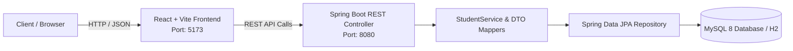

# 🎓 Student Management System (SMS)

[](https://www.oracle.com/java/technologies/downloads/#java21)
[](https://spring.io/projects/spring-boot)
[](https://react.dev/)
[](https://vitejs.dev/)
[](https://www.mysql.com/)
[](LICENSE)

A modern, production-structured full-stack **Student Management System** built with **Spring Boot 3** and **Java 21** on the backend, paired with an interactive, responsive **React + Vite** frontend.

---

## 📌 Table of Contents

- [Features](#-features)
- [Architecture & Tech Stack](#-architecture--tech-stack)
- [Database Schema](#-database-schema)
- [REST API Reference](#-rest-api-reference)
- [Project Structure](#-project-structure)
- [Quick Start Guide](#-quick-start-guide)
  - [Prerequisites](#prerequisites)
  - [Option 1: Run with MySQL (Production Setup)](#option-1-run-with-mysql-production-setup)
  - [Option 2: Run with H2 In-Memory (Zero-Setup Demo)](#option-2-run-with-h2-in-memory-zero-setup-demo)
  - [Run the React Frontend](#run-the-react-frontend)
- [Configuration & Environment Variables](#-configuration--environment-variables)
- [Build & Deployment](#-build--deployment)
- [Contributing & License](#-contributing--license)

---

## ✨ Features

- **Full CRUD Operations**: Register, browse, search, update, and remove students seamlessly.
- **Server-Side Pagination & Sorting**: Efficiently query large datasets using Spring Data JPA `Pageable` (`page`, `size`, `sortBy`, `sortDir`).
- **DTO Layer Abstraction**: Complete separation between client request/response models and database entities.
- **Jakarta Bean Validation**: Field validation (`@NotBlank`, `@Email`, `@Min`, `@Max`, `@Size`) with clear localized error messages.
- **Global Exception Handling**: Centralized `@RestControllerAdvice` converting exceptions into RFC-7807 style structured JSON responses (`400 Bad Request`, `404 Not Found`, `409 Conflict`, `500 Server Error`).
- **Cross-Origin Resource Sharing (CORS)**: Configured to support frontend client communication out of the box.
- **Interactive React UI**:
  - Live backend health status badge.
  - One-click **⚡ Auto-Fill Sample Data** button for rapid testing.
  - Inline update and deletion modal confirmation.
  - Dynamic error toast notifications displaying server-side validation feedback.
- **Dual Architecture Reference**: Demonstrates both **Package-by-Layer** (`com.example.studentmanagement`) and **Package-by-Feature** (`com.sms`) structures.

---

## 🛠 Architecture & Tech Stack



### Backend
- **Java 21** (LTS)
- **Spring Boot 3.3.4**
  - `spring-boot-starter-web`: Spring MVC RESTful APIs with embedded Tomcat
  - `spring-boot-starter-data-jpa`: Hibernate ORM & Spring Data repositories
  - `spring-boot-starter-validation`: Jakarta Bean Validation
- **MySQL Connector/J 8.3** & **H2 Database** (embedded profile)
- **Project Lombok**: Boilerplate reduction (`@Getter`, `@Setter`, `@Builder`, `@RequiredArgsConstructor`)

### Frontend
- **React 19**
- **Vite 6** (Fast HMR development server & production bundler)
- **Modern Responsive CSS**: Mobile-friendly, zero external UI framework dependencies

---

## 🗄 Database Schema

The `students` table is managed automatically by Hibernate (`ddl-auto=update`):

```sql
CREATE TABLE students (
    id BIGINT NOT NULL AUTO_INCREMENT PRIMARY KEY,
    first_name VARCHAR(100) NOT NULL,
    last_name VARCHAR(100) NOT NULL,
    email VARCHAR(255) NOT NULL,
    phone VARCHAR(20),
    age INT,
    course VARCHAR(150),
    CONSTRAINT uk_student_email UNIQUE (email)
);
```

---

## 📡 REST API Reference

Base URL: `/api/v1/students`

| Method | Endpoint | Description | Status Codes |
| :--- | :--- | :--- | :--- |
| `POST` | `/api/v1/students` | Create new student | `201 Created`, `400 Bad Request`, `409 Conflict` |
| `GET` | `/api/v1/students/{id}` | Retrieve student by ID | `200 OK`, `404 Not Found` |
| `GET` | `/api/v1/students` | Get paginated list of students | `200 OK` |
| `PUT` | `/api/v1/students/{id}` | Update existing student | `200 OK`, `400 Bad Request`, `404 Not Found`, `409 Conflict` |
| `DELETE` | `/api/v1/students/{id}` | Delete student record | `204 No Content`, `404 Not Found` |

### Sample Request (`POST /api/v1/students`)
```json
{
  "firstName": "John",
  "lastName": "Doe",
  "email": "john.doe@example.com",
  "phone": "+1-555-0199",
  "age": 21,
  "course": "Computer Science"
}
```

### Sample Response (`201 Created`)
```json
{
  "id": 1,
  "firstName": "John",
  "lastName": "Doe",
  "email": "john.doe@example.com",
  "phone": "+1-555-0199",
  "age": 21,
  "course": "Computer Science"
}
```

### Paginated Query Parameters (`GET /api/v1/students`)
- `page`: Page index (default: `0`)
- `size`: Items per page (default: `10`)
- `sortBy`: Field name to sort by (default: `id`)
- `sortDir`: Sort direction `asc` or `desc` (default: `asc`)

---

## 📂 Project Structure

```text
student-management-system/
├── frontend/                                # React + Vite frontend
│   ├── src/
│   │   ├── App.jsx                          # Main React UI component
│   │   ├── App.css                          # Application styling
│   │   └── main.jsx                         # React DOM mount point
│   ├── package.json                         # Frontend dependencies & scripts
│   └── vite.config.js                       # Vite configuration
├── src/
│   ├── main/
│   │   ├── java/
│   │   │   └── com/example/studentmanagement/
│   │   │       ├── controller/              # REST API Controllers (@RestController)
│   │   │       ├── dto/                     # Request & Response DTOs
│   │   │       ├── entity/                  # JPA Database Entities (@Entity)
│   │   │       ├── exception/               # Custom exceptions & GlobalExceptionHandler
│   │   │       ├── repository/              # Spring Data JPA interfaces
│   │   │       ├── service/                 # Business logic interfaces & implementations
│   │   │       └── StudentManagementApplication.java  # Main Application Entry Point
│   │   └── resources/
│   │       ├── application.properties       # Default configuration (MySQL)
│   │       └── application-h2.properties    # In-memory database profile (H2)
├── pom.xml                                  # Maven dependencies & build configuration
├── start-backend.bat                        # Windows 1-click backend launcher
├── start-frontend.bat                       # Windows 1-click frontend launcher
├── .gitignore                               # Standard Git ignore rules
└── README.md                                # Project documentation
```

---

## 🚀 Quick Start Guide

### Prerequisites
- [Java 21 JDK](https://www.oracle.com/java/technologies/downloads/#java21) or higher
- [Apache Maven 3.9+](https://maven.apache.org/)
- [Node.js 18+](https://nodejs.org/) & npm
- [MySQL Server 8.0+](https://dev.mysql.com/downloads/mysql/) (optional if using H2 profile)

---

### Option 1: Run with MySQL (Production Setup)

1. **Create the MySQL Database**:
   ```sql
   CREATE DATABASE IF NOT EXISTS sms_db;
   ```

2. **Configure Credentials**:
   Either set environment variables:
   ```bash
   export DB_USERNAME=root
   export DB_PASSWORD=your_mysql_password
   ```
   Or edit `src/main/resources/application.properties`:
   ```properties
   spring.datasource.username=root
   spring.datasource.password=your_mysql_password
   ```

3. **Start Spring Boot**:
   ```bash
   mvn spring-boot:run
   ```
   *The backend will start at `http://localhost:8080` and Hibernate will automatically create the required database tables.*

---

### Option 2: Run with H2 In-Memory (Zero-Setup Demo)

No MySQL installation required:
```bash
mvn spring-boot:run -Dspring-boot.run.profiles=h2
```
* **H2 Web Console**: Access `http://localhost:8080/h2-console`
  - **JDBC URL**: `jdbc:h2:mem:sms_db`
  - **User**: `sa`
  - **Password**: *(leave blank)*

---

### Run the React Frontend

Open a new terminal window:
```bash
cd frontend
npm install
npm run dev
```

Visit **`http://localhost:5173`** in your browser.

> **Tip for Windows users**: You can also launch both services by double-clicking `start-backend.bat` and `start-frontend.bat`.

---

## ⚙️ Configuration & Environment Variables

| Variable | Default Value | Description |
| :--- | :--- | :--- |
| `DB_USERNAME` | `root` | MySQL database user |
| `DB_PASSWORD` | `Root@123` | MySQL database password |
| `server.port` | `8080` | Spring Boot server port |
| `spring.profiles.active` | default (MySQL) | Set to `h2` for in-memory testing |

---

## 📦 Build & Deployment

### Package the Backend (JAR)
```bash
mvn clean package -DskipTests
```
The executable self-contained fat JAR will be generated at:
```text
target/student-management-system-0.0.1-SNAPSHOT.jar
```
Run with:
```bash
java -jar target/student-management-system-0.0.1-SNAPSHOT.jar
```

### Build Frontend for Production
```bash
cd frontend
npm run build
```
Optimized static production files will be output to `frontend/dist/`.

---

## 📄 Contributing & License

Contributions, issues, and feature requests are welcome! Feel free to check the issues page.

This project is licensed under the [MIT License](LICENSE).
